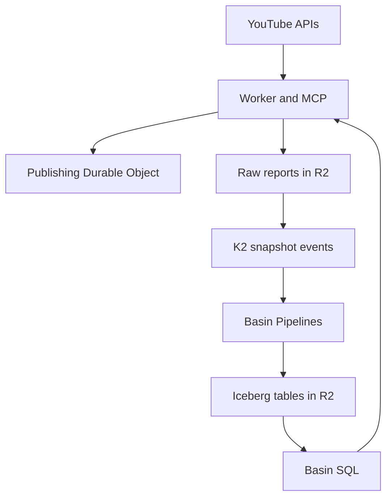

# YouTube publishing and analytics PoC

One owner-only Cloudflare Worker schedules and updates Rawkode Academy livestreams, retrieves real channel analytics, and exposes both through REST and an OAuth-protected MCP endpoint for ChatGPT. The same YouTube authorization covers publishing and analytics.

Publishing uses a SQLite Durable Object to keep reviewed plans, broadcast IDs and incomplete creation attempts. Analytics reports are archived in private R2, announced through K2, consumed into Basin Pipelines, and written as Iceberg tables in a second private R2 bucket. Stored queries run through Basin SQL. Pipelines batches Iceberg commits at a 60-second roll interval; accepting an event is not proof that it is queryable yet.



Each warehouse row contains one complete report snapshot. Replaying an event keeps its content-derived ID; reads choose the newest whole snapshot for the exact query. Duplicate delivery and later YouTube corrections cannot inflate totals or mix partial snapshots. Raw API pages remain available for validation and replay.

See [COSTS.md](COSTS.md) for current prices, workload assumptions, and a reproducible best/worst-case calculator.

## Verify locally

Requires Node 24 and npm. This PoC is deliberately excluded from the root Bun workspaces and uses its own `package-lock.json`; its focused CI does not depend on installing the full monorepo. From the repository root:

```sh
cuenv sync -A
cd projects/rawkode.academy/platform/youtube-control
npm ci --workspaces=false
npm run check --workspaces=false
npm test --workspaces=false
python3 -m unittest discover -s test -p '*_test.py'
```

`npm test` builds the Worker and runs unit, failure-recovery and Miniflare acceptance tests. Google, K2 and Basin calls are mocked; these tests do not publish videos or access live streams. Miniflare and workerd are pinned to support the Worker's compatibility date. Native K2 bindings use real resources even in local development, so the acceptance tests deliberately replace them with local RPC mocks. Do not use `wrangler dev` as an offline test substitute.

The checked-in `wrangler.jsonc` is a type-generation/build template with zero resource IDs. `npm run deploy` rejects it. Provisioning writes an ignored `wrangler.deploy.jsonc` with actual IDs. No API credentials belong in either config.

## Authorize Google

Enable **YouTube Data API v3** and **YouTube Analytics API** in a Google Cloud project. Configure its OAuth consent screen for the owner. Create two OAuth clients in that project:

| Client | Purpose | Configuration |
| --- | --- | --- |
| Desktop application | Offline channel access shared by publishing and analytics | Download the client JSON to a private local path. |
| Web application | Owner sign-in when connecting ChatGPT | Redirect URI: `https://<worker-name>.<subdomain>.workers.dev/oauth/callback`. |

Run the existing authorization helper on the desktop where you can complete Google consent:

```sh
uv run ../../tasks/youtube-scheduler/authorize.py \
  --client-secrets /private/google-desktop-client.json \
  --channel UCrber_mFvp_FEF7D9u8PDEA \
  --output /private/youtube.credentials.json
```

The helper verifies channel ownership and saves the refresh credential with mode `0600`. It requests publishing, YouTube read access, analytics read access and OpenID identity. For the MCP login allowlist, identify the human Google account independently of the YouTube/Brand-account chooser:

```sh
uv run scripts/oauth-owner.py --client-secrets /private/google-desktop-client.json
```

This helper requests only OpenID identity, verifies Google's signed response, saves no credentials, and prints the nonsecret subject to use as `MCP_OWNER_GOOGLE_SUB`. Select that same account for the MCP Web sign-in. The subject printed by `authorize.py` may differ when a Brand account is selected; do not substitute a wildcard or relax the exact owner check.

An external Google OAuth app left in **Testing** can issue refresh tokens that expire after seven days for these scopes. Use the appropriate production/internal consent configuration for continued use. A revoked grant requires running the helper again and replacing the Worker secret.

## Provision isolated Cloudflare resources

Requires a Workers Paid account with K2, R2 and Basin available. The setup script creates or reuses resources with one PoC prefix, refuses incompatible existing resources, and creates no API tokens. It never enables public R2 buckets or unauthenticated HTTP ingestion.

Load these credentials through your secret manager before running setup. Do not put values in shell history, command arguments or committed files.

| Environment variable | Use |
| --- | --- |
| `CLOUDFLARE_API_TOKEN` | Provision/deploy the PoC: Workers scripts and KV, R2 buckets/catalog, K2 streams and Pipelines management in the target account. |
| `BASIN_SINK_TOKEN` | Catalog maintenance and the Pipelines sink. Requires the documented R2 Admin Read & Write access; restrict to the PoC warehouse where supported. It is stored by Cloudflare's catalog/sink, not in Wrangler config. |
| `K2_CONSUME_TOKEN` | Create the named subscription and later consume/ack it. Requires K2 Consume in the target account. |

Choose the Worker URL before provisioning and register its exact callback on the Google Web client. The helper supports an isolated `workers.dev` deployment; custom-domain routing can be added explicitly afterwards.

```sh
npm run setup -- \
  --account-id YOUR_CLOUDFLARE_ACCOUNT_ID \
  --origin https://rawkode-academy-youtube-control-poc.YOUR_SUBDOMAIN.workers.dev \
  --owner-sub YOUR_GOOGLE_SUB
```

This prints a resource plan without making network requests. Repeat with `--apply` to create it:

```sh
npm run setup -- \
  --account-id YOUR_CLOUDFLARE_ACCOUNT_ID \
  --origin https://rawkode-academy-youtube-control-poc.YOUR_SUBDOMAIN.workers.dev \
  --owner-sub YOUR_GOOGLE_SUB \
  --apply
npm run deploy -- --dry-run
npm run deploy
```

Setup creates three private R2 buckets (assets, raw reports, warehouse), a Basin Catalog, a seven-day K2 stream/subscription, a structured Basin stream, a Parquet/Iceberg sink, its SQL pipeline, and an OAuth KV namespace. The sink creates `default.youtube_reports`. Resource IDs are also saved in `.poc-resources.json` for inspection and cleanup. A lost create response can be reconciled by rerunning setup; it discovers resources by their exact names.

The first deployment fails closed until its secrets are installed. Create independent script API tokens locally and upload them without printing their values:

```sh
node scripts/create-api-tokens.mjs
npx wrangler secret bulk .poc-api-tokens.secrets.json --config wrangler.deploy.jsonc
npx wrangler secret put YOUTUBE_CREDENTIALS_JSON --config wrangler.deploy.jsonc < /private/youtube.credentials.json
npx wrangler secret put MCP_GOOGLE_CLIENT_ID --config wrangler.deploy.jsonc
npx wrangler secret put MCP_GOOGLE_CLIENT_SECRET --config wrangler.deploy.jsonc
npx wrangler secret put K2_CONSUME_TOKEN --config wrangler.deploy.jsonc
npx wrangler secret put BASIN_SQL_TOKEN --config wrangler.deploy.jsonc
```

The four final commands prompt securely. `MCP_GOOGLE_CLIENT_*` are the Web application credentials. `BASIN_SQL_TOKEN` requires Basin SQL read, Basin Catalog access and the R2 permissions specified in the [current authentication guide](https://developers.cloudflare.com/basin-sql/query-data/#authentication). The Worker executes only predefined read queries. Do not reuse the general deployment token as a runtime credential.

## Test the deployed PoC

```sh
npm run smoke -- --wait-seconds 180
```

This checks the MCP authentication boundary/discovery, refreshes real channel analytics, archives the report, drains K2 into Pipelines, waits for a Basin query to return that snapshot or a newer one, and prints a private broadcast plan. It creates no YouTube broadcast. A genuine empty analytics report is allowed and remains empty; absent dates are not fabricated as zeroes.

After reviewing that plan, run the publishing acceptance test:

```sh
npm run smoke -- --publish --wait-seconds 180
```

It uses the saved `smoke-session.json`, creates a **private** broadcast for tomorrow, updates its description, and verifies the same ID and private visibility. The test never starts a stream. Repeated runs reuse that session, and the broadcast remains in YouTube Studio for inspection and manual deletion. Use a new `--session` filename for a later independent test. Real public session manifests are rejected by this smoke helper.

The test reports success only after both publishing and real Basin retrieval succeed. If ingestion is delayed, allow up to `--wait-seconds 600` and inspect `/v1/status` plus Basin Pipeline delivery/user-error metrics. `accepted_by_k2` and a successful Pipeline send mean durable ingestion, not immediate Iceberg visibility. The consumer ACKs K2 only after Pipelines accepts a validated snapshot.

## Connect ChatGPT

In ChatGPT, open **Plugins**, select **+**, then **Add custom MCP server**. Enter a name and this public HTTPS endpoint:

```text
https://<worker-name>.<subdomain>.workers.dev/mcp
```

Choose **OAuth** with **Dynamic Client Registration (DCR)**, review the server warning, select **Create as a plugin**, and install it. Your account/workspace must permit custom MCP connections and write actions for the publishing test. The Worker advertises authorization metadata, DCR and `offline_access` for refresh tokens; do not paste the script API token into ChatGPT. Complete Google sign-in as the configured owner and explicitly select publishing access only when you want it. The Web client's Google callback is `/oauth/callback`; the downstream client's callback is supplied by ChatGPT during OAuth registration. The provider handles authorization code, PKCE, refresh and revocation endpoints through discovery. See [OpenAI's connection instructions](https://help.openai.com/en/articles/12584461-connecting-custom-mcp-servers-in-chatgpt) and [OAuth requirements](https://developers.openai.com/plugins/build/auth).

First ask for channel analytics over a recent seven-day range. For publishing, ask it to prepare a private test session and review the returned title, description, time and visibility before applying its `planId`. Read-only grants must not expose or authorize `apply_session`. Disconnect/revoke the MCP grant when testing is complete. Downstream MCP credentials are separate from the Google refresh credential and never reveal it.

| MCP tool | Behavior |
| --- | --- |
| `get_analytics` | `summary`, `daily`, `top_videos`, `traffic`, `retention`, `concurrent_viewers`; retention/concurrency require one `videoId`. |
| `get_broadcast` | Read current owned broadcast metadata, without stream keys. |
| `plan_session` | Prepare the complete change set; plan expires after 15 minutes. |
| `apply_session` | Publishing scope only. Apply a reviewed plan and verify its result. |

## API and operations

REST endpoints use the independent `READ_API_TOKEN` / `WRITE_API_TOKEN` bearer credentials. MCP uses OAuth; browser origins are checked and credentials never belong in URLs.

| Endpoint | Access | Purpose |
| --- | --- | --- |
| `GET /health` | Public | Process health only; does not prove Google authorization or ingestion. |
| `GET /v1/status` | Read | Channel/configuration, sync/drain and outbox status. |
| `POST /v1/analytics/query` | Read | Query a stored report; `refresh:true` fetches Google and queues a new snapshot. |
| `POST /v1/analytics/sync` | Write | Refresh recent channel daily/summary/top/traffic reports. |
| `POST /v1/analytics/drain` | Write | Flush the outbox, consume K2 and hand reports to Pipelines. |
| `POST /v1/analytics/replay` | Write | Requeue `{ "snapshotId": "..." }` from its verified R2 archive. |
| `POST /v1/sessions/plan` | Read | Preview changes for a stable Academy `sessionId`. |
| `POST /v1/sessions/apply` | Write | Apply `{ "planId": "..." }`. |
| `GET /v1/broadcasts/{id}` | Read | Fetch and verify channel ownership. |
| `POST /v1/thumbnails` | Write | Upload JPEG/PNG bytes (up to 2 MiB); use the returned SHA-256 in a plan. |

Cron refreshes recent reports daily at 08:17 UTC and drains pending ingestion every five minutes. A failed K2 send remains in the Durable Object outbox. After five failures it is retained for inspection/replay rather than discarded. A failed consumer batch is not ACKed; a replayed snapshot does not add its metrics twice. Stored queries keep using the latest warehouse snapshot until an explicit refresh or daily collection replaces it; there is no 15-minute refetch TTL. Responses expose the original `fetchedAt`, latest returned `dataThrough` where available, missing dates, and a refresh recommendation after 36 hours. Reading stored reports requires a successful Google Analytics collection within the previous 30 days. If that gate expires, `refresh:true` must revalidate authorization; a disconnected/revoked grant must be replaced before continued service.

Publishing has no automatic retry of non-idempotent creation. If a response is lost, a new plan reconciles by the original title/time; an unresolved outcome requires inspecting YouTube and supplying its ID. A missing known ID never creates a replacement. External metadata edits, expired plans and changed visibility/audience settings require a new review. Thumbnail upload acknowledgement still needs a visual check on YouTube.

Only a validated Google rejection with HTTP 400, 401, 403 or 404 clears the creation intent and permits a fresh reviewed plan; the old plan remains failed, while timeouts, server errors and malformed responses retain the uncertain intent.

Snippet updates send the read-back ETag in `If-Match`. Conditional updates are documented for the general YouTube Data API, but this header's behavior on `liveBroadcasts.update` still needs a live acceptance check. Thumbnail and encoder-binding operations have a remaining race with simultaneous YouTube Studio edits between their final read and write. Avoid concurrent Studio edits during an apply and inspect the verified result afterwards.

## Boundaries and cleanup

This PoC serves one configured channel, upcoming livestreams and six owned-analytics reports. It does not start broadcasts, upload recordings, manage multi-tenant access, or provide thumbnail-impression/CTR and monetary reporting yet. Reports accept 1–92 days in YouTube's `America/Los_Angeles` reporting timezone. The warehouse stores complete report snapshots keyed by exact report/filter/date selection, with a 512 KiB serialized snapshot limit. It is not yet a generalized fact warehouse or dashboard.

To revoke access, disconnect the ChatGPT app/grant, revoke the Google application's account grant, and remove/rotate the Worker secrets. To delete the PoC's stored data, remove its Worker, OAuth KV namespace, K2 stream/subscription, Basin pipeline/sink/catalog, and dedicated R2 buckets listed in `.poc-resources.json`. Delete the catalog/table through the documented Cloudflare controls before emptying warehouse storage. Delete local credential and API-token files afterwards. This is deliberately manual and limited to the isolated PoC; setup does not delete resources or touch production Academy buckets.

Offline verification is not live acceptance. The development environment lacked `cuenv`, so the full monorepo/generated CI was not run there. The focused checks and mocked acceptance suite are reproducible above; complete the deployment smoke test and ChatGPT browser consent with your real credentials before treating the service as operational.

References: [K2 production and consumption](https://developers.cloudflare.com/k2/), [Basin Pipelines](https://developers.cloudflare.com/basin-pipelines/), [Iceberg sink and batching](https://developers.cloudflare.com/basin-pipelines/sinks/available-sinks/r2-data-catalog/), [YouTube report combinations](https://developers.google.com/youtube/analytics/channel_reports), [MCP on Workers](https://developers.cloudflare.com/agents/model-context-protocol/).
